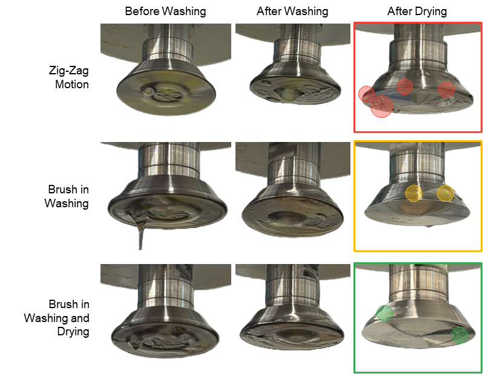
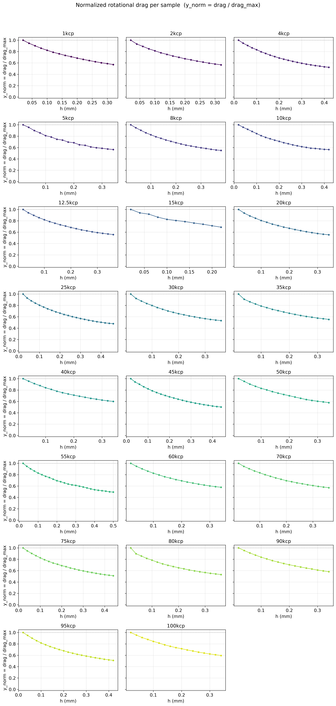
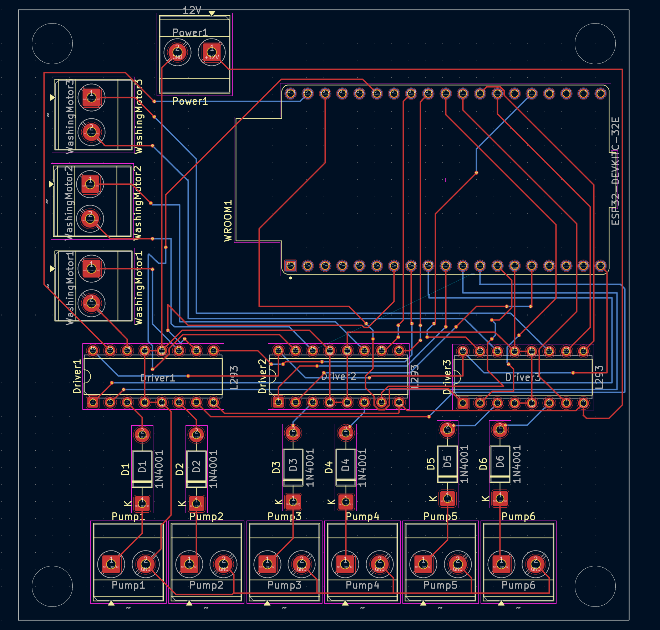

# Supplementary Information

## AutoVisco: Physics-Informed Autonomous Rheometry of Liquids, Gels, and Pastes for Self-Driving Laboratories

Mohammad M Rastegardoosta,\*, Ian Ngungab, Koketso Gaborekwec, Zeqing Baoa, Hani Naguibd, Frantz Le Devedeca,\*

a Acceleration Consortium, University of Toronto, Toronto, ON, Canada

b Department of Biological Sciences, University of Toronto Scarborough, Toronto, ON, Canada

c Department of Mechanical and Mechatronics Engineering, University of Waterloo, Waterloo, Canada

d Department of Materials Science and Engineering, University of Toronto, Toronto, ON, Canada

\* Corresponding authors: frantz.ledevedec@utoronto.ca and m.rastegardoost@utoronto.ca

**Data availability:** All data, control software, firmware, analysis notebooks, and figure scripts supporting this work are openly available in a public GitHub repository at https://github.com/AC-Formulations-SDL5/AutoVisco (data portal: https://ac-formulations-sdl5.github.io/AutoVisco/).

**Contents**

- S1. Bill of materials (**Table S1**)
- S2. Washing-protocol evaluation (**Fig. S1**)
- S3. Dimensionless collapse of silicone drag curves (**Fig. S2**)
- S4. Washing-subsystem electronics (**Fig. S3**)

## S1. Bill of Materials

**Table S1** lists the components of the automated viscometry platform. Apart from the rotational torquemeter, the platform is built from low-cost commercial and 3D-printed parts.

**Table S1.** Bill of materials for the automated rheology platform.

| Component | Specification/Model | Manufacturer/Source | Material/Notes | Cost (USD) |
| --- | --- | --- | --- | --- |
| Robotic Motion | 4040-PRO Desktop CNC | Genmitsu (SainSmart) | Cartesian coordinate system | 700.00 |
| Torque Sensor | Torquemeter (Max: 7,187.0 dyne·cm) | AMETEK Brookfield | Real-time torque-displacement | 14,500.00 new (3,000.00 used); incl. spindle |
| Rotational Spindle | Cone-shaped (3° angle, 12.0 mm radius) | AMETEK Brookfield | Stainless steel construction | (included above) |
| Sample Containers | Flat-bottom, high-clearance cylinders | Custom/Commercial | Stainless steel; resistant to deformation | 30.00 |
| Platform Layout | T-Slotted Aluminum Rails | McMaster-Carr | Modular design for scalable layout | 530.00 |
| Container Holders | Custom fitting for T-slotted rails | Fabricated (FDM) | PETG filament (Bambu 3D Printer) | 100.00 |
| Washing Module Housing | Motor container and driving spinner | Fabricated (FDM) | PETG filament (Bambu 3D Printer) | 100.00 |
| Washing Container | High-chemical resistance vessel | Fabricated (SLA) | Rigid 10K Resin (Formlabs) | 100.00 |
| Washing Drive System | DC Motor (12 mm, 1,000:1 gear ratio) | Various | Driving/Driven spinners with magnetic repulsion | 10.00 |
| Fluid Management | Peristaltic Pumps | Chi.Bio (Univ. of Oxford) | Regulates media input and waste removal | 100.00 |
| Cleaning Interfaces | Smooth contact mat and weatherstrip brush | Various | Contact mat and brush lining container holder | 20.00 |

## S2. Washing-Protocol Evaluation

Four spindle-cleaning protocols of increasing mechanical complexity were benchmarked on high-viscosity samples: a static spindle, synchronous co-rotation, lateral oscillation, and a multi-modal combination of rotation, oscillation, and brushing. Only the multi-modal protocol left no detectable high-viscosity residue on the cone, and it was adopted as the platform default.

**Figure S1.** Comparison of washing protocols for the cone-shaped spindle.

## S3. Dimensionless Collapse of Silicone Drag Curves

Normalizing each silicone drag sweep by its own maximum and plotting it against the common gap axis collapses the traces onto a single master shape. This supports factorizing the drag into a geometry-governed shape function F(h) and a viscosity-dependent amplitude A(μ), which is the assumption that allows one silicone calibration to transfer to other fluids (main text, Section 2.3.3).

**Figure S2.** Dimensionless collapse of silicone drag curves, supporting factorization into geometry shape and viscosity amplitude.

## S4. Washing-Subsystem Electronics

The washing subsystem is controlled by an ESP32 microcontroller on a custom PCB. PWM-driven L298N motor drivers actuate six pumps and three agitation motors through a multiplexed, diode-isolated channel-sharing configuration, and detergent, water, and isopropanol rinse cycles are triggered from a minimal host command interface.

**Figure S3.** PCB layout and embedded motor-control architecture of the washing subsystem.
