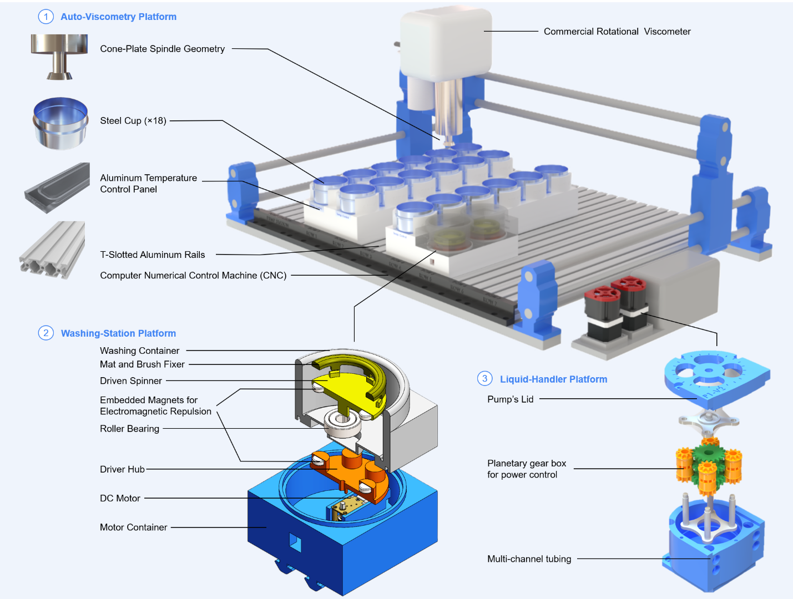
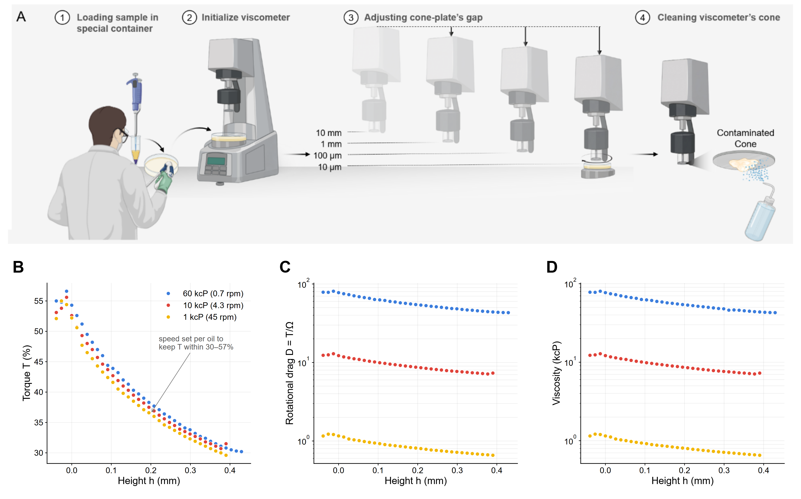
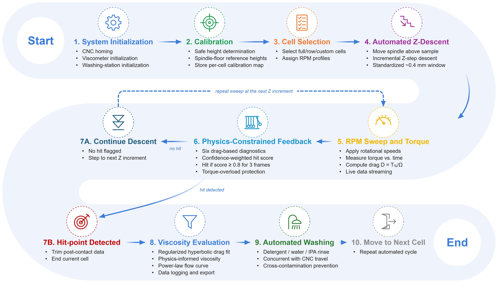
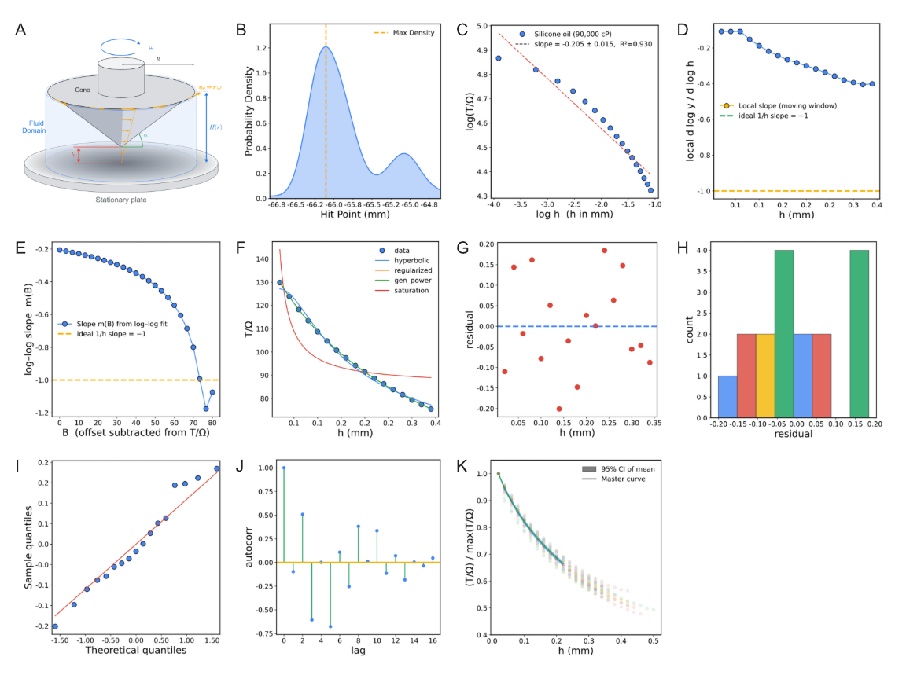
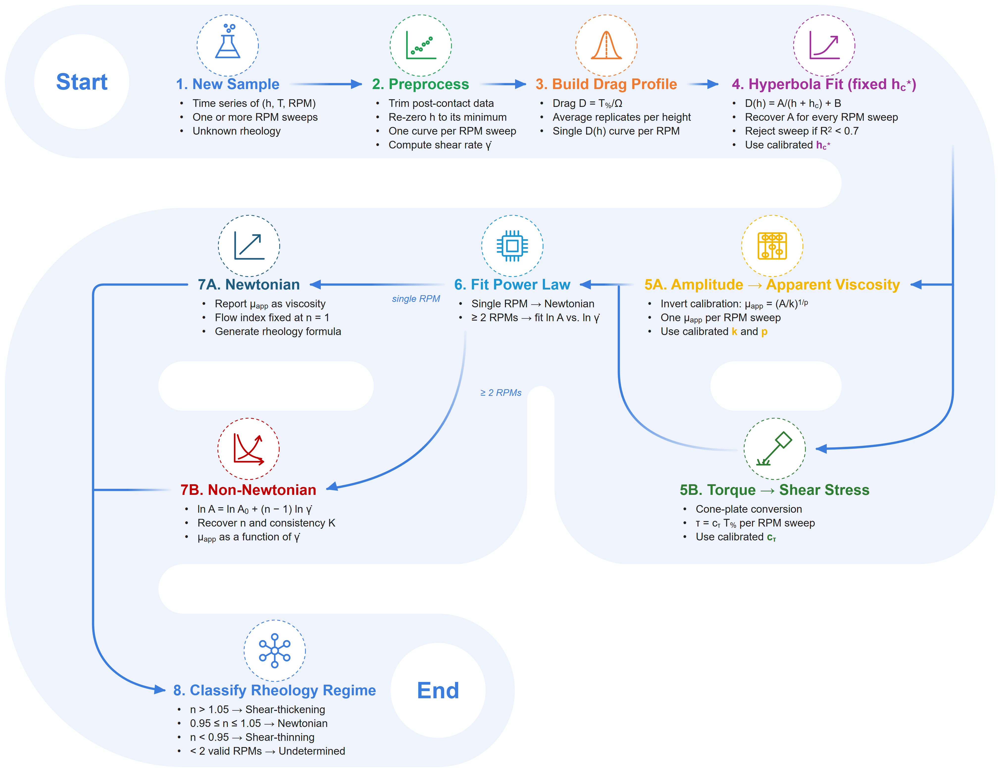
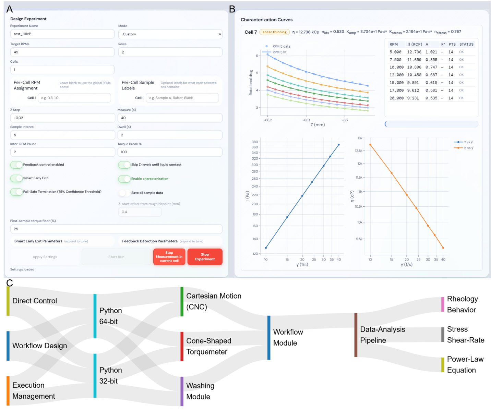
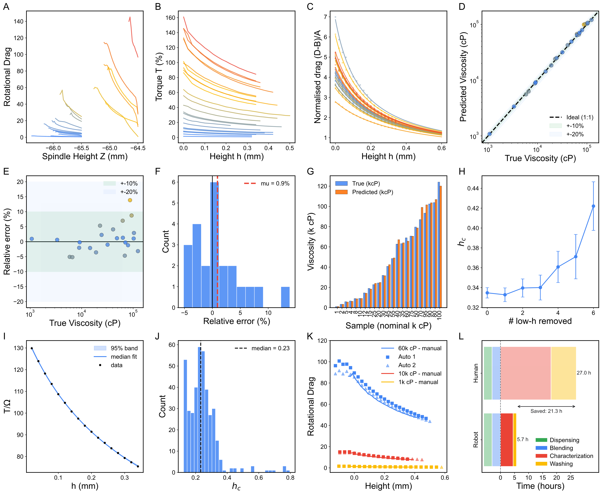
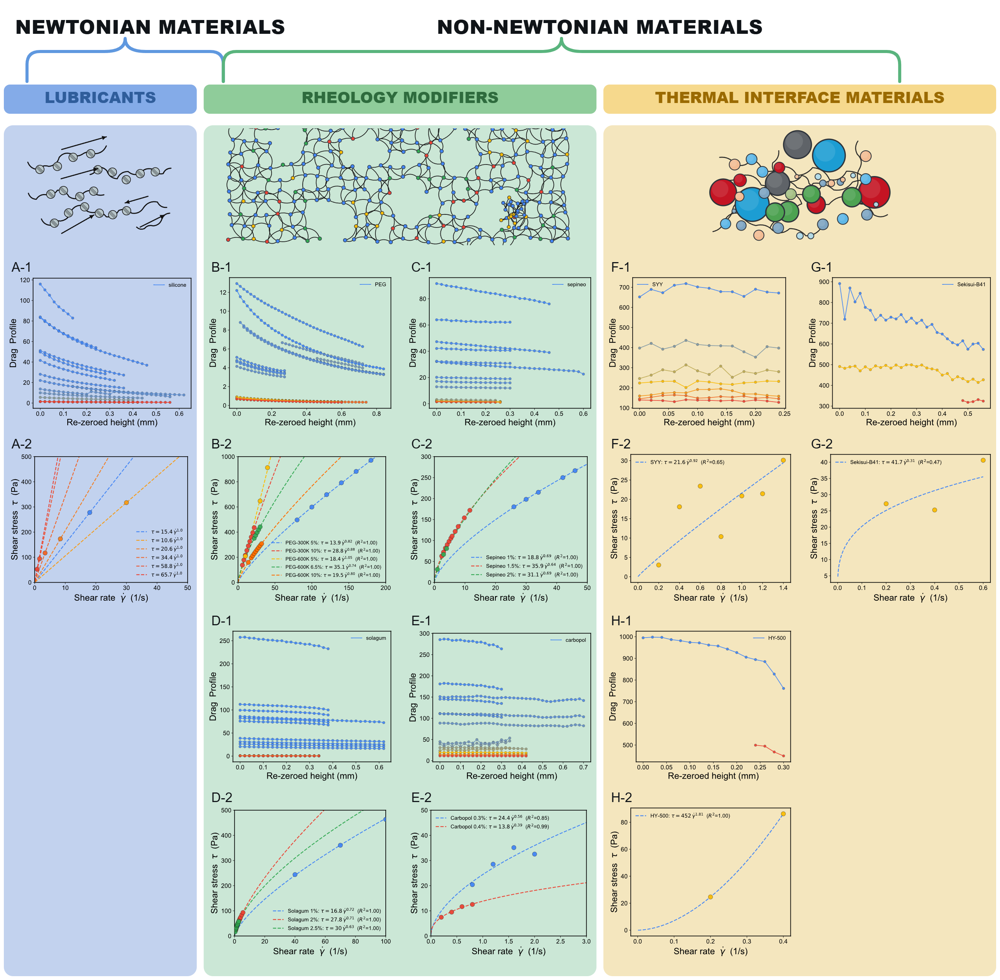
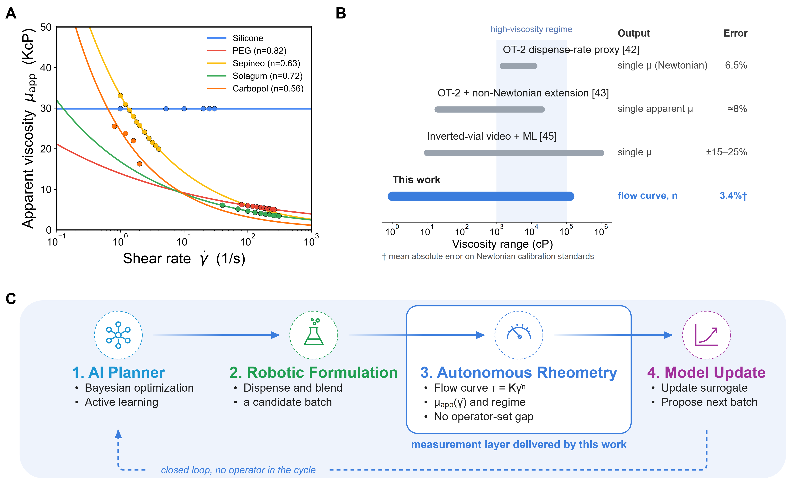

# AutoVisco: Physics-Informed Autonomous Rheometry of Liquids, Gels, and Pastes for Self-Driving Laboratories

Mohammad M Rastegardoosta,\*, Ian Ngungab, Koketso Gaborekwec, Zeqing Baoa, Hani Naguibd, Frantz Le Devedeca,\*

a Acceleration Consortium, University of Toronto, Toronto, ON, Canada

b Department of Biological Sciences, University of Toronto Scarborough, Toronto, ON, Canada

c Department of Mechanical and Mechatronics Engineering, University of Waterloo, Waterloo, Canada

d Department of Materials Science and Engineering, University of Toronto, Toronto, ON, Canada

\* Corresponding authors: frantz.ledevedec@utoronto.ca and m.rastegardoost@utoronto.ca

# Abstract

Rheological characterization of viscous formulations is central to lubricants, coatings, adhesives, pharmaceutical and personal-care products, and polymer processing, yet it remains one of the least automated measurements in materials development. Conventional cone-and-plate and parallel-plate rheometry depend on controlled loading and precise gap setting, which complicates robotic operation. We present an automated viscometry platform that reframes viscosity acquisition as a signal-interpretation problem rather than a geometric-precision one. A cone-shaped rotational torquemeter, a Cartesian motion stage, and a dual-stage washing module operate under an asynchronous multi-runtime control architecture. As the spindle descends, it generates torque–displacement signatures that a physics-constrained pipeline decodes into rheology. On Newtonian silicone-oil standards, viscosity is recovered with a mean absolute error of 3.4%, with 95.7% of calibration samples within ±10%. From multi-speed descents, the pipeline reconstructs calibrated stress–shear-rate relationships and fits the power-law model τ = Kγ̇ⁿ, where n = 1 denotes a Newtonian response and n < 1 indicates shear thinning. Across six material families spanning 0.001–125 Pa·s (1–125,000 cP), the platform reproduces reference rheology within ±2× and recovers flow-behaviour indices from n = 1.00 (Newtonian) to n = 0.39 (strongly shear-thinning). It processes 18 samples in approximately 5 hours with less than 20 minutes of hands-on effort, whereas an equivalent manual characterization-and-washing workflow takes 4.7 times as long. Both outputs come from one fixed pipeline with no per-chemistry retuning, reducing reliance on precision gap-setting hardware. The platform is positioned as the measurement layer for closed-loop rheology-discovery campaigns, in which Bayesian optimization and active learning propose formulations that it then characterizes autonomously.

**Keywords:** automated rheology, cone-and-plate viscometry, physics-constrained inference, power-law fluids, self-driving laboratory, high-throughput characterization.

# 1. Introduction

Viscosity decides whether a formulation can be pumped, sprayed, spun into fibres, or spread into a coating, and precise control of precursor viscosity is therefore essential for processing functional materials. The fabrication of porous and fibrous polymer components for triboelectric energy harvesters [1], for example, depends on controlling the flow of electrospinning solutions and foam- or aerogel-forming precursors to reach target fibre and pore morphologies. The same challenge arises across energy-harvesting materials and functional coatings, yet viscosity is still usually measured by hand and outside the formulation feedback loop. It is most acute in the high-viscosity regime (1–100 Pa·s; 1,000–100,000 cP) that underpins lubricants [2], specialty coatings [3,4], pharmaceutical and injectable formulations [5], personal-care emulsions [6,7], and adhesives [8], where rheology dominates processability and resolving even one composition landscape can demand hundreds of measurements. Manual rotational rheometry is limited by operator-controlled gap setting, loading, cleaning, and pacing. Standard metrology guidelines specify gap and zero-point tolerances at the tens-of-micrometre scale [9], a precision that a trained operator routinely maintains by feel [10] but that an unmodified positioning stage, lacking the operator's contact sensing and effective gap control, may not. As a result, even a modest design-of-experiments campaign can cost days of skilled labour, and inter-operator variance further erodes comparability across trials.

A common workaround replaces experiments with empirical mixing models, such as the logarithmic blending rule, Grunberg–Nissan [11], Ramírez-de-Santiago [12], and Redlich–Kister [13], which interpolate multi-component viscosity from pure-component or binary references. These models are accurate in dilute, near-ideal regimes [14] but break down at industrially relevant concentration extremes [15,16], where hydrogen bonding, associative interactions, polymer entanglement, and microgel structuring produce non-ideal behaviour that empirical kernels cannot capture [17,18]. Blending-rule error for hydrocarbon mixtures rises from near zero to over 13% under colder, more complex conditions [15], and in a comparison of seventeen mixing rules for petroleum blends only four remained acceptable, with no single rule generalizing across the full range [17]. Without a reliable computational surrogate, physical measurement remains central to any rigorous formulation programme; what must be reduced is the cost of measurement, not the measurement itself.

Self-driving laboratories (SDLs) offer a pragmatic route to shorter development timelines [19,20]. By combining closed-loop robotic handling, automated characterization, and machine-learning-guided decision-making, they have compressed development cycles from years to weeks in reaction optimization [21–26], materials discovery [27–29], catalysis [30,31], and polymer processing [32], and now include mobile robots that choose their own experiments [33]. In these loops the decision algorithm is rarely the bottleneck: active-learning strategies already routinely outperform grid or random search [34–39]. The real constraint is characterization fast and reliable enough to keep pace with the software [40,41]. For viscosity, automation has mostly repurposed liquid-handling robots as proxies. Opentrons (OT-2) platforms calibrated against dispense rates recover Newtonian viscosity over 1,500–12,000 cP with 6.5% error [42], a window later widened to 20–20,000 cP at approximately 8% error through a simple non-Newtonian extension [43]; open-hardware digital pipettes have pushed dispensing accuracy below 1% [44]; and a camera-based inverted-vial method spans 0.01–1,000 Pa·s at ±15–25% error without any contact sensor [45]. These methods, like commercial microfluidic RheoSense-type viscometers, are fast and inexpensive, but each returns a single, largely Newtonian viscosity value; none can autonomously recover a full non-Newtonian constitutive curve. Rotational rheometry, the technique that does provide this information, therefore remains underrepresented among self-driving characterization layers.

To close this gap, we analyse the torque signal generated as the rotating cone approaches the stationary plate, rather than relying on manual adjustment of an absolute gap. Torque rises as the clearance narrows, and a regularized, lubrication-motivated fit to the drag–displacement trace yields a viscosity-sensitive amplitude while accommodating uncertainty in the effective gap offset. Repeating the descent at several rotation rates then gives a stress–shear-rate relation: a power-law index n ≈ 1 describes near-Newtonian behaviour, whereas n < 1 indicates shear thinning [46]. Yield-stress effects [47,48] may cause departures from a pure power law and cannot be confirmed from n alone. The calibrated analysis reduces sensitivity to mechanical backlash and gap-zero uncertainty, while still requiring repeatable motion and valid torque data.

In this work, we present an end-to-end automated viscometry platform that delivers, for viscous formulations within its torque and speed ranges, a calibrated stress–shear-rate flow curve and the fitted power-law equation τ = Kγ̇ⁿ. A Cartesian motion stage, a cone-shaped rotational torquemeter, and a magnetically driven washing station are integrated into one workstation for autonomous measurement and cleaning across a multi-cell deck (**Fig. 1**). We treat the spindle's descent as a physically structured signal: lubrication theory constrains the functional form of the drag, while a data-driven inference layer absorbs the stage's mechanical and geometric uncertainties into nuisance parameters, recovering viscosity and flow-behaviour index without per-chemistry retuning. A one-shot calibration transfers unmodified across six chemistries spanning five orders of magnitude in viscosity (1–125,000 cP). It reproduces reference rheology within ±2×, identifies Newtonian and shear-thinning responses, and flags behaviour not adequately described by a simple power law, all while completing 18-sample runs in ~5 h of robot time with under 20 min (7%) of human involvement. The platform is thus positioned as the measurement layer for closed-loop rheology-discovery campaigns driven by Bayesian optimization and active learning.

**Figure 1.** The automated viscometry platform: Cartesian motion stage, cone-shaped rotational torquemeter, multi-cell sample deck, and dual-stage washing station.

# 2. Methods

Every rheological modality answers a different question about how a material flows, so choosing one is itself a design decision with direct consequences for automation. Rheology spans extensional, oscillatory, and steady-shear deformation, each yielding a distinct descriptor (**Table 1**). This work targets steady-state shear rheology acquired through rotational, torque-based measurement, for three converging reasons: it is (i) directly automatable on a Cartesian motion stage, (ii) able to estimate apparent viscosity and, with multi-speed measurements, the power-law exponent that describes Newtonian or shear-thinning response, and (iii) compatible with the footprint of a multi-cell sample deck. Performed manually, this measurement reduces to three operator-controlled steps: loading the sample into a flat-bottom cell, aligning the spindle precisely against the cell floor, and acquiring torque under a programmed angular velocity. The platform automates sample positioning, controlled descent, and torque acquisition, while retaining feedback on the safe stopping position.

Other rheometers could also characterize these fluids. Parallel-plate rotational rheometry measures shear-thinning formulations, capillary rheometry probes pressure-driven flow over different shear-rate ranges, and cone-and-plate rheometry is not restricted to high-viscosity systems. We chose a cone-shaped spindle because it integrates with the compact robotic stage and approaches a nearly uniform shear-rate geometry at small tip clearances. The intended application is automated screening of viscous, polymer-containing formulations, such as the fluoropolymer solutions electrospun into porous and fibrous triboelectric mats [49,50], across multiple sample cells, where reproducible positioning, sample loading, and, above all, removal of residual high-viscosity material between cells are the central engineering constraints. The geometry is therefore a platform-design choice, not a claim that alternative rheometers cannot characterize these fluids.

**Table 1.** Rheology Principles and Methods

| Category | Principle/Method | Key Metric |
| --- | --- | --- |
| Deformation Type | Shear Rheology | Shear Stress, Shear Rate |
|  | Extensional Rheology | Extensional Viscosity |
| Flow Regime | Steady-state Flow | Apparent Viscosity |
|  | Oscillatory (Dynamic) | Storage (G') & Loss (G'') Moduli |
| Measurement Method | Rotational (Torque-Based) | Torque-Displacement |
|  | Capillary/Pipe Flow | Pressure Drop |
|  | Microfluidics | Shear-thinning profiles |
| Material Response | Newtonian | Linear Stress-Strain relationship |
|  | Non-Newtonian | Power-law index |
|  | Viscoelastic | Phase Angle |

The idea of driving the spindle through a continuous descent, instead of seating it once at a fixed gap, came directly from manually collected data (**Fig. 2A**). A scientist lowered the spindle in discrete 13 µm increments, from increment 33 down to increment −3 relative to the container floor, running each oil at a fixed spindle speed (0.7, 4.3, and 45 rpm for the 60, 10, and 1 kcP silicone oils, respectively) chosen to keep torque within roughly 30–57% of full scale, and recording the resulting torque together with the viscosity back-calculated from the standard cone-and-plate relation. The procedure took approximately 4.5 hours per material and yielded a compact dataset of up to 37 rows per material (one per tested height) and four columns: increment number, spindle speed, measured torque, and measured viscosity. Plotted against height, these readings formed a torque–displacement trace for each material (**Fig. 2B**). Dividing torque by angular speed turned each trace into a rotational-drag signature whose shape varied systematically and distinguishably with viscosity (**Fig. 2C–D**). Because every parameter of the underlying viscosity equation is encoded in this drag–displacement relationship, the drag amplitude at a given gap correlated directly with viscosity. This observation motivated the central shift in strategy behind the platform: rather than a single measurement at one gap, the full descent is treated as the information-bearing signal.

**Figure 2.** Origin of the descent-based measurement. (A) Manual protocol: sample loading, viscometer initialization, stepwise lowering of the cone in 13 µm increments, and cleaning by hand. (B) Torque, (C) rotational drag, and (D) viscosity versus height for three silicone oils, recorded manually.

## 2.1 Hardware Architecture and Automated Workflow

The integrated layout is shown in **Figure 1**, and the complete list of materials is given in **Table S1**. Sample containers are stainless-steel, flat-bottom, high-clearance cylinders held in a modular platform of T-slotted aluminium rails (McMaster-Carr) with FDM-printed PETG container holders. The sensing element is a 3°-cone-angle, 12.0 mm-radius stainless-steel spindle coupled to a precision rotational torquemeter (AMETEK Brookfield; full-scale torque Mfull = 7,187.0 dyne·cm), referred to hereafter as the rotational torquemeter, with its manufacturer-quoted flow curves referred to as the reference rheology. Three-axis motion is provided by a Cartesian CNC stage (Genmitsu 4040-PRO, SainSmart) driven by NEMA 17 steppers and T10 lead screws, and dedicated peristaltic pumps (Chi.Bio, University of Oxford) meter the washing station's cleaning fluids.

Repeated automated measurement of viscous formulations is only meaningful if residue from one sample does not bias the torque reading of the next. A dedicated washing station therefore cleans the spindle after every cycle using a bespoke magnetic-repulsion drive: a motor-driven, magnet-embedded spinner inside a PETG housing actuates a second, driven spinner across a 3.0 mm gap inside a separate SLA-printed washing vessel, so the motor electronics never contact the cleaning fluids. Detergent, water, and isopropanol are routed through the pumps in sequence. Of four benchmarked protocols of increasing mechanical complexity (static spindle, synchronous co-rotation, lateral oscillation, and a multi-modal combination of rotation, oscillation, and brushing), only the multi-modal protocol left no detectable high-viscosity residue. It was adopted as the platform default and runs concurrently with CNC travel, keeping washing off the critical path (**Fig. S1**).

These components operate as a closed, operator-free loop (**Fig. 3**). After initialization, the system calibrates the safe spindle-to-container height for each cell and then runs an automated characterization cycle, in which the spindle descends incrementally while torque is recorded under a programmed RPM sweep. A physics-constrained feedback layer, combining rotational-drag tracking, statistical trend analysis, confidence-weighted hit-point detection, and second-derivative anomaly detection, identifies the liquid-contact transition and the optimal termination point, protecting the sensor from overload. Each measurement ends with a washing sequence that launches concurrently with travel to the next cell, and the resulting torque–displacement record is passed to the analysis pipeline.

<!-- Vector source: ../../Images/Figure3_workflow_v2.svg (generated by ../../Images/workflow_figures_v2.py) -->

**Figure 3.** Closed-loop workflow of the platform, from initialization and calibration, through descent with physics-constrained hit detection, to viscosity evaluation and concurrent washing.

## 2.2 Physics-Informed Rheological Framework

The platform operates as a modified cone-and-plate configuration in which the cone approaches a stationary plate while torque is monitored as a function of vertical displacement. Unlike a manual measurement (**Fig. 2B–D**), an automated descent inevitably sweeps a much wider gap range than an operator would program, so the torque trace does not stay within a single hydrodynamic regime. It passes in succession through parallel-plate-dominated, transition, and cone-and-plate-dominated behaviour, and no single closed-form solution captures all three. We therefore adopt a generalized lubrication-theory framework, in the classical tradition of cone-and-plate and parallel-plate rotational rheometry [10], that interpolates continuously between the two asymptotic limits (**Fig. 4A**).

The local liquid thickness between the rotating cone and the stationary plate is

$$H(r) = h + r \tan\alpha \tag{1}$$

where h is the minimum tip clearance, r is the radial coordinate, and α is the cone angle, i.e., the angle between the cone surface and the plate (3° here). For large spindle separations (h ≫ r tan(α)), the gap thickness becomes nearly uniform across the radius (H(r) ≈ h). In this regime, the system approaches classical parallel-plate rotational rheometry, where the torque scales approximately as

$$T \propto \frac{\mu \omega R^4}{h} \tag{2}$$

and the viscous resistance is governed by the global spindle-to-substrate distance. Conversely, for very small clearances (h → 0), the radial contribution dominates the gap profile (H(r) ≈ r tan(α)), and the system converges toward the classical cone-and-plate limit with a nearly uniform shear rate across the radius. The analytical torque then becomes

$$T = \frac{2\pi}{3} \frac{\mu \omega R^3}{\tan\alpha} \tag{3}$$

Between these two limits lies a transition regime in which the finite tip clearance and the cone geometry jointly set the shear field, and neither approximation is accurate on its own. A generalized lubrication-theory framework was therefore used to describe shear stress and torque continuously across the entire displacement range.

Under incompressible, laminar, axisymmetric, low-Reynolds-number conditions, the dominant fluid motion is azimuthal and radial and axial inertia can be neglected, so the governing momentum equation reduces to

$$\mu \frac{\partial^2 u_\theta}{\partial z^2} = 0 \tag{4}$$

With no-slip boundary conditions at the rotating cone and the stationary plate, the azimuthal velocity distribution becomes

$$u_\theta(r,z) = \frac{\omega r z}{H(r)} \tag{5}$$

which yields the local shear stress

$$\tau(r) = \frac{\mu \omega r}{H(r)} \tag{6}$$

The total torque follows from radial integration of the local viscous moment:

$$T = 2\pi\mu\omega \int_{0}^{R} \frac{r^3}{H(r)} \, dr \tag{7}$$

Equation 7 provides a single physics-informed descriptor that remains continuous across the parallel-plate, transition, and cone-and-plate regimes traversed by the automated descent.

Moving from manual to autonomous rheometry does not remove the platform's dependence on gap height; it relocates the burden of controlling it. The Cartesian stage is built around NEMA 17 stepper motors and T10 lead screws with a manufacturer-quoted running accuracy of ±0.01 mm. In practice, cumulative mechanical uncertainties push the effective positional variance to nearly 0.1 mm in the worst case, an order of magnitude beyond the nominal specification (**Fig. 4B**). This variance arises from backlash, thermal expansion of the metallic guides, structural compliance of the 3D-printed PETG fixtures, and load-dependent sag as the ~9 kg torque transducer deflects the vertical guide rails. Rather than chase this uncertainty in hardware, we exploit the physical structure encoded in equations (1)–(7). Because the shape of the torque-versus-gap signature depends strongly on fluid viscosity, a real-time, feedback-driven analysis of the descent can detect both the liquid-contact transition and the safe termination point without ever knowing the absolute value of h. The feedback layer therefore (i) absorbs residual positional uncertainty as a fitted parameter rather than a calibration error, (ii) protects the torque sensor from collision-induced overload, and (iii) stops each downward motion once the contact-detection criteria are met, before a collision can compromise the measurement.

<!-- Source panels in repo: (B) ../../Images/hitpoints_histogram.svg; (C) figures_rheology/02_loglog_focus.svg; (E) figures_rheology/02b_slope_vs_B.svg; (F) figures_rheology/04_direct_fits.svg; (G-J) figures_rheology/06_residuals_best.svg; (K) figures_rheology/13_master_publication.svg -->

**Figure 4.** Physics-informed framework. (A) Cone–plate geometry of the lubrication model. (B) Effective positional variance of the stage. (C–E) Log–log scaling, local-slope, and offset-scan diagnostics of D(h). (F) Comparison of candidate models. (G–J) Residual diagnostics of the regularized hyperbola. (K) Master curve with bootstrap envelope.

## 2.3 Data-Analysis Pipeline: from Raw Data to Rheological Behaviour

Every automated-descent record (h, T(%), and Ω) passes through exactly the same analysis pipeline, regardless of the fluid that produced it.

### 2.3.1 Signal transformation and scaling diagnosis

Before any transformation, each raw descent record is trimmed to discard data acquired after the spindle reaches the container floor, so that end-of-travel contact cannot inject non-physical torque spikes into the downstream gap–torque regression. Contact is detected in real time by a windowed statistical monitor that evaluates six diagnostic parameters computed from the rotational-drag signal D and its coefficient-of-variation transform CV(D): the coefficients of determination R² of D, of CV(D), and of the first time-derivative D′, together with the second time-derivatives D″, CV(D)″, and (D′)″. Each parameter carries an equal weight of 0.2 in a composite confidence score, so a frame is flagged as a hit once at least four of the six indicators cross their anomaly thresholds simultaneously (confidence score ≥ 0.8). To reject isolated noise transients, the descent is terminated only after three consecutive hit-flagged frames, and the record is truncated to the last pre-contact sample before entering the transformation pipeline.

The first transformation is rotational-drag normalization,

$$D \equiv \frac{T_{\%}}{\Omega} \tag{8}$$

where Ω is the spindle speed in rpm. This normalization removes the trivial linear dependence of torque on angular speed for a Newtonian response and isolates the remaining geometry–fluid coupling. A global and local log–log slope diagnosis on the silicone set immediately ruled out the simplest hypothesis: no single power law D ∝ h−n explains the full descent range (**Fig. 4C**). The local slope drifts toward −1 only near contact, so a pure 1/h model is asymptotically correct but globally incomplete (**Fig. 4D**).

To identify the correct baseline structure, we performed an offset scan, subtracting candidate constants B from D and refitting the log–log slope of the positive residual (**Fig. 4E**). The resulting plateau near a slope of −1 confirmed the leading-order form D = A/h + B.

### 2.3.2 Model selection in physical space

Four candidate models (pure hyperbola, regularized hyperbola, generalized power, and saturation) were compared in physical space using bounded Levenberg–Marquardt fitting and ranked by R², adjusted R², AIC, BIC, and cross-validated RMSE (**Fig. 4F**). The regularized hyperbola won on every criterion:

$$D(h) = \frac{A}{h + h_c} + B \tag{9}$$

Here, A carries the viscosity information, hc absorbs effective zero-gap effects (slip layer, asperities, compliance, and residual geometric offsets), and B is a small parasitic baseline. Residual diagnostics confirm that the selected model is unbiased and near-homoscedastic across gap height, supporting a stable downstream inverse calibration (**Fig. 4G–J**).

### 2.3.3 Universality of geometry shape and fixed-hc production fitting

We next tested the factorization hypothesis D(h, μ) = A(μ) F(h) directly, by normalizing each sweep by its own maximum and overlaying all silicone traces on a common gap axis. Their collapse onto a single master shape (**Fig. 4K** and **Fig. S2**) validates a geometry-governed F(h) and a fluid-dependent amplitude A. This is the central assumption that allows one calibration to transfer across every subsequent fluid.

A global fit to the normalized master curve also favours the regularized form as the most parsimonious representation (**Fig. 4K**), which justifies extracting a single universal geometric regularization length hc⋆ for production fitting. Operationally, each sweep is first fitted with a free hc, and the median of the high-quality fits (R² > 0.7, hc ∈ [0.05, 1.5] mm) defines hc⋆ (0.277 mm for this geometry). Every sweep is then refitted with hc fixed at hc⋆, which reduces parameter coupling and improves the identifiability of the amplitude.

### 2.3.4 Calibration equations and constitutive extension

Silicone standards provide the one-shot amplitude–viscosity calibration,

$$\ln A = \ln k + p \ln \mu \quad \Longleftrightarrow \quad \mu_{\mathrm{app}} = \left(\frac{A}{k}\right)^{1/p} \tag{10}$$

For non-Newtonian materials measured at multiple RPM values, the amplitude instead becomes shear-rate dependent,

$$A(\dot{\gamma}) = A_0 \, \dot{\gamma}^{\,n-1} \tag{11}$$

so the slope of ln A versus ln γ̇ returns the flow-behaviour index n directly. Shear stress follows from percent torque through the cone–plate conversion

$$\tau\,[\mathrm{Pa}] = c_\tau \, T_{\%}, \qquad c_\tau = \frac{3 M_{\mathrm{full}}/100}{2\pi R^3} \approx 1.986\ \mathrm{Pa}/\% \tag{12}$$

Uncertainty and robustness are quantified throughout by leave-the-k-smallest-out sensitivity on near-contact points, 500-iteration bootstrap confidence bands for (A, hc, B), and a distributional analysis of per-sweep hc to check universality.

Taken together, these steps form a single inference chain (**Fig. 5**) that is executed identically for Newtonian and non-Newtonian materials with no per-chemistry redesign: the burden of adapting to a new chemistry falls entirely on the data, never on the code.

<!-- Vector source: ../../Images/Figure5_pipeline_v2.svg (generated by ../../Images/workflow_figures_v2.py) -->

**Figure 5.** Inference pipeline from raw descent record to rheological class. The constants hc⋆, k, p, and cτ are calibrated once and reused across chemistries.

## 2.4 Software Orchestration

Rotational sensing, robotic positioning, and washing are integrated within a single control plane. The torquemeter is paired with the three-axis CNC stage for programmable traversal and repeatable spindle alignment, and all machine-level coordinates (e.g., sample and washing positions, safe-height offsets, and per-cell calibration) are parameterized in YAML files, so the deck layout can be reconfigured without touching the control software. An ESP32 microcontroller runs the washing subsystem: a custom PCB with PWM-driven L298N motor drivers actuates six pumps and three agitation motors through a multiplexed, diode-isolated channel-sharing configuration, executing detergent/water/isopropanol rinse cycles from a minimal host command interface (**Fig. S3**).

At the host level, a dual-Python asynchronous architecture accommodates the torquemeter's proprietary 32-bit communication DLL while keeping orchestration centralized. A 64-bit runtime handles workflow execution, G-code motion control, washing sequencing, and data logging, and exchanges data with the isolated 32-bit torquemeter runtime through synchronized file-based communication. Modular hardware-abstraction layers (CNC, viscometer, washing, and analysis trigger) enable the non-blocking, concurrent execution of motion, acquisition, and washing that underlies the platform's throughput, together with traceability (calibration status, software version, environmental conditions) and recovery mechanisms (instrument reconnection, safe-motion interruption). A real-time web dashboard exposes live torque–displacement traces, batch progress, and manual override, abort, and calibration controls, and closes each batch with an automated report of per-cell results.

**Figure 6** traces this coordination end-to-end. Dashboard screenshots show the operator input screen (**Fig. 6A**) and the live rotational-drag record with the final characterization curve (**Fig. 6B**). A Sankey diagram (**Fig. 6C**) maps operator actions from the Web Interface through the Python runtimes to the Hardware layer, coordinated by the Workflow Engine into the Data-Analysis Pipeline and out to the recovered rheological outputs, so that every result remains traceable to the workflow decision, hardware channel, and operator input that produced it.

**Figure 6.** Software orchestration. (A) Operator input screen. (B) Live drag record and final characterization curve with fitted power-law parameters. (C) Flow of control and data from the web interface through the Python runtimes and hardware to the analysis pipeline and outputs.

# 3. Results and Discussion

With every equation, fitting rule, and uncertainty calculation fixed in the Methods, we now turn to the experimental evidence in two stages. We first establish that the automated measurement layer is accurate, reproducible, and statistically robust, and then ask whether it preserves rheological meaning across Newtonian and non-Newtonian materials.

## 3.1 Acquisition Performance and Reproducibility

We evaluated the automated measurement layer with silicone oils spanning 1–125 kcP, a Newtonian reference family suited to calibration and reproducibility testing. Two questions guided the analysis: can viscosity be recovered accurately, and do the raw drag signatures acquired during descent contain a transferable physical structure that automated inference can exploit?

**Figure 7A** shows representative rotational-drag traces during descent. Drag rises monotonically as the gap closes, consistent with lubrication-type flow, and the traces remain systematically ordered by viscosity throughout. At this stage of the study, before a per-cell calibration mode existed, the recorded height window was sample-dependent rather than fixed: pooled across the library, the stage traversed 1.9 mm (−66.4 to −64.5 mm), but individual sweeps covered from as little as ~0.16 mm (120 kcP) to ~0.88 mm (1 kcP). This reflected the lack of a standardized per-cell descent window rather than a torque limitation, since the 120 kcP oil still reached only 50% of full-scale torque at this gap. Per-cell calibration now standardizes the sweep to ~0.4 mm for every cell (≈20 Z-height measurements feeding the rheology pipeline), the protocol used for all subsequent calibrated tests. Even so, drag remains far from interchangeable across viscosities: the 1 kcP oil never exceeds D ≈ 0.56, while the 120 kcP oil never falls below D ≈ 250.

The raw torque–gap data used for model fitting reveal distinct limits at the smallest gaps (**Fig. 7B**), where the highest-viscosity oils read up to 160% of the sensor's rated full-scale torque (100% = 7,187.0 dyne·cm). These near-contact readings therefore carry lower a priori confidence, and this instrumentation ceiling is flagged as a target for a future hardware revision. Fitting each curve with D(h) = A/(h + hc) + B and normalizing as (D − B)/A tests whether the gap dependence is universal. The normalized silicone traces collapse from sample-dependent values of 3–7 at zero gap onto a common value of approximately 1.5 at a 600 µm gap (**Fig. 7C**), showing that the fitted gap dependence is approximately shared and that viscosity is isolated in the amplitude A. This approximate factorization supports reuse of the silicone-derived calibration without chemistry-specific retuning, provided measurements remain within the instrument's valid operating window. Reliable washing of the cone between highly viscous polymer samples is equally important for obtaining comparable repeated measurements.

The calibration holds up under test. Predicted and reference viscosities track the parity line across more than two orders of magnitude, with 22 of 23 samples (95.7%) within ±10% (**Fig. 7D**); the single outlier, at 87.0 kcP, sits at +13.9%. Errors show no systematic trend with viscosity (**Fig. 7E**) and are narrowly distributed around zero, with a mean of +0.9%, a standard deviation of 4.6%, a mean absolute error of 3.4%, and 74% of samples within ±5% (**Fig. 7F**). The sample-by-sample comparison confirms the same agreement (**Fig. 7G**). Absolute error nevertheless scales with viscosity, from approximately 360 cP (2.7%) in the lower half of the range to roughly 3,340 cP (4.2%) in the upper half, a nearly nine-fold increase in absolute terms, even though the relative error stays in the single digits throughout.

We next asked whether the fitted geometric parameter hc reflects the measurement geometry or is merely a fitting artefact. In a leave-the-k-smallest-out analysis (**Fig. 7H**), hc drifts only mildly as near-contact points are discarded, shifting by 26% from 0.335 mm with the full dataset to 0.422 mm with six points removed, while its standard error grows gracefully from ±0.005 to ±0.024 mm and A remains essentially unaffected. Bootstrap resampling agrees: every point of a representative sample falls inside a narrow 95% reconstruction band (**Fig. 7I**), and the bootstrap distribution of hc is narrow and unimodal, with a median of 0.23 mm, a standard deviation of 0.10 mm, and a 95% confidence interval of 0.14–0.50 mm (**Fig. 7J**), small relative to the viscosity span of the set. This evidence supports treating hc as a geometry-linked constant that can be fixed globally, reducing the inverse problem to two free parameters. Uncertainty from the fitting layer is then well below the material-to-material variation the system is designed to resolve, and mechanical imperfections such as backlash, compliance, wetting variability, and positioning error are absorbed smoothly into the regularized drag representation without compromising viscosity recovery.

Finally, **Figure 7K** benchmarks the platform against a human operator at three viscosities (1, 10, and 60 kcP). Fitting the same regularized hyperbolic drag model to all nine traces, manual and automated alike, gives R² of 0.982–0.996 in every case, confirming that both acquisition modes follow the same physical drag law despite differing raw amplitudes from separate gap-zero references. In other words, the platform extracts the same physics a trained operator would obtain by hand. It does so far faster: the full acquisition, washing, analysis, and handling sequence processed 18 samples in approximately 5 hours without operator intervention (**Fig. 7L**). Excluding the upstream formulation steps common to both workflows, characterization and washing required 27.0 hours of continuous manual work versus 5.7 hours of unattended robot time, a saving of 21.3 hours (roughly 4.7-fold) achieved without sacrificing data quality. This establishes the automated layer as a practical foundation for closed-loop rheology-discovery campaigns.

<!-- Vector source: OneDrive Images/Figure 7_v2.svg (panels H and J relabelled h_0 -> h_c). Related repo panels: figures_rheology/08_sensitivity_regularized.svg (H), 09_bootstrap_band.svg (I), 09_bootstrap_hists.svg (J); ../../Images/timeline_breakdown_bar.svg (L) -->

**Figure 7.** Calibration, validation, and robustness on silicone standards. (A) Drag profiles during descent. (B) Raw torque–gap data. (C) Collapse of normalized drag profiles. (D) Predicted versus reference viscosity. (E) Relative error versus viscosity and (F) its distribution. (G) Sample-by-sample comparison. (H) Sensitivity of hc to removal of near-contact points. (I) Bootstrap reconstruction and (J) bootstrap distribution of hc. (K) Human versus robotic acquisition. (L) Time breakdown of autonomous versus manual workflows.

## 3.2 Material Performance: Newtonian and Non-Newtonian Materials

Reproducibility on a calibration fluid answers only part of the question. The platform must also recover physically meaningful rheology across distinct chemistries with one fixed inference workflow. The decisive test is therefore not whether the system repeats, but whether it preserves constitutive meaning as the material moves from a Newtonian standard to complex, structure-forming formulations. **Figure 8** assembles this evidence.

### 3.2.1 Lubricant (Newtonian Anchor)

Silicone oils serve as the Newtonian anchor and validate the core decoding hypothesis that the drag amplitude maps onto a stable apparent viscosity without geometry-specific retuning. **Figure 8A-1** shows the expected single-regime drag response, and the reconstructed stress–shear-rate behaviour stays close to linear, corresponding to a near-constant apparent viscosity (μapp) over the measured window (**Fig. 8A-2**). Fitting τ = Kγ̇ⁿ to six representative sweeps returns n = 1.00 in every case, the exact Newtonian value, while the consistency index K (numerically equal to the apparent viscosity for the cone geometry) spans 10.6–65.7 Pa·s across the samples. The uniform n = 1.00 shows that the pipeline classifies Newtonian behaviour unambiguously regardless of viscosity, while the spread in K shows that it simultaneously tracks the magnitude of that viscosity. This is exactly what a chemically simple, weakly structured fluid should return, and it provides the physical baseline against which the non-Newtonian results below are read.

### 3.2.2 Rheology Modifier Materials

Applied to high-molecular-weight PEGs (poly(ethylene glycol), Polyox™ WSR N750-300K and Polyox™ WSR 205-600K, IFF), Sepineo™ 600 (acrylamide/sodium acryloyldimethyltaurate copolymer, Seppic), Solagum™ SF 306 (Acacia senegal gum + xanthan gum), and Carbopol® 980 (crosslinked poly(acrylic acid), Lubrizol) under multi-RPM sweeps, the same pipeline traces a chemically interpretable progression from Newtonian-like to strongly non-Newtonian behaviour.

PEG shows mild-to-moderate shear thinning, consistent with chain alignment reducing hydrodynamic resistance at higher shear rates (**Fig. 8B**). For PEG-300K, n rises slightly from 0.82 (5%) to 0.88 (10%) as K increases from 13.9 to 28.8, whereas for PEG-600K, n falls from 1.05 (5%, essentially Newtonian) to 0.74 (6.5%) as K increases from 18.4 to 35.1. At a matched ~5% loading, the higher K of PEG-600K (18.4 vs. 13.9) already signals its higher viscosity before either grade departs from Newtonian behaviour.

Sepineo and Solagum shear-thin more strongly, reflecting the progressive breakdown and reorganization of polymer-entangled and associative networks under shear [51] (**Fig. 8C–D**). For Sepineo, n drops from 0.69 (1%) to 0.64 (1.5%) before recovering to 0.69 (2%), while K rises from 18.8 to a maximum of 35.9 (1.5%) and then falls to 31.1 (2%). This behaviour is non-monotonic but confined to a narrow band (n = 0.64–0.69), suggesting a network structure that is not strongly concentration-sensitive over this range. Solagum trends more cleanly: n falls from 0.72 (1%) to 0.71 (2%) to 0.63 (2.5%) as K rises from 16.8 to 27.8 to 30.0, so the gum becomes both more shear-thinning and more viscous with concentration.

Carbopol approaches yield-pseudoplastic behaviour, with an apparent low-shear resistance that gives way to flow once the material yields [47] (**Fig. 8E**). Its flow index falls sharply from 0.56 (0.3%) to 0.39 (0.4%), the strongest shear thinning of any modifier tested, and the 0.3% fit is markedly poorer (R² = 0.85) than the other modifier fits (R² ≥ 0.99), a signature of the low-shear yield plateau that a pure power law cannot fully capture. This entire progression emerges from a single calibrated model stack: the chemistry-specific behaviour is resolved by the data, not imposed by per-material tuning.

### 3.2.3 Thermal Interface Materials

Thermal interface material (TIM) formulations, including SYY, Sekisui B-41, and HY-500 (Halnzie), push the test space toward highly filled, application-driven materials with complex internal architecture. The platform still returns stable drag-to-stress reconstructions within the same autonomous workflow (**Fig. 8F–H**), but data density and fit quality both degrade relative to the lubricants and modifiers. SYY's raw drag profile is visibly non-smooth (**Fig. 8F-1**), and this noise propagates into the fitted power law τ = 21.6γ̇0.92, which reaches only R² = 0.65 (**Fig. 8F-2**), far below the modifier fits, because most readings for this high-viscosity, low-torque-margin sample fall above the sensor's accurate range. Sekisui B-41 also shear-thins (**Fig. 8G**), but only three spindle-height conditions stayed within the measurable torque window before lower gaps exceeded it, leaving a fit of τ = 41.7γ̇0.31 with R² = 0.47. HY-500 (**Fig. 8H**) appears shear-thickening, with a fitted τ = 452γ̇1.81, but this inference rests on only two measured points plus the origin; the nominal R² = 1.00 carries no real statistical weight with so few degrees of freedom, so the trend should be read as preliminary. Both limitations trace to the same hardware ceilings, a maximum measurable torque of 7,187.0 dyne·cm and a minimum spindle speed of 0.1 rpm, which compress the usable operating window for high-viscosity TIM systems into a handful of points. The TIM results are therefore best read as feasibility-level evidence that points to the torque range and low-speed control of the next hardware iteration, rather than to a limitation of the pipeline.

**Figure 8.** Drag profiles (panels -1) and stress–shear-rate curves (panels -2) for (A) silicone, (B) PEG, (C) Sepineo, (D) Solagum, (E) Carbopol, (F) SYY, (G) Sekisui B-41, and (H) HY-500.

**Figure 9A** brings these results together on a single apparent-viscosity–shear-rate map, where rheological class is encoded directly by slope and curvature rather than by isolated viscosity values. Silicone sits on a near-horizontal Newtonian line, confirming that the calibration backbone remains physically coherent across the tested shear-rate window, while PEG, Solagum, Sepineo, and Carbopol peel away along progressively steeper power-law slopes (n < 1) that reflect increasingly strong shear thinning, all captured by the same inference chain with no chemistry-specific retuning. That the geometry-normalized drag formalism and fixed calibration preserve constitutive meaning across such mechanistically distinct formulations is the central result of this rheogram. It is also operationally useful, allowing materials to be ranked by process-relevant shear response (e.g., pumpability, spreadability, coating behaviour, or the processability of aerogel-forming precursors [52]) within one consistent coordinate system.

**Figure 9.** (A) Apparent viscosity versus shear rate for representative formulations. (B) Viscosity range, output, and error of automated viscometry methods compared with this work. (C) The platform as the measurement layer of a closed-loop formulation campaign.

**Figure 9B** places the platform among existing automated-viscometry approaches, where it occupies a different position in the trade-off between range, accuracy, and constitutive detail. OT-2 pipetting proxies [42,43] and the camera-based inverted-vial method [45] each return a single apparent viscosity per fluid, are limited to Newtonian or weakly non-Newtonian behaviour, and cover at most a few decades of viscosity (20–20,000 cP [43]; 0.01–1,000 Pa·s [45]) at 6.5–25% error. The present platform spans 1–125,000 cP and, instead of a single value, returns a calibrated stress–shear-rate flow curve with a fitted power-law index, while recovering Newtonian calibration standards with a 3.4% mean absolute error. This added detail comes at the cost of per-sample speed: a pipetting proxy needs a single dispense stroke, whereas each measurement here involves a multi-height, multi-RPM descent followed by a wash cycle. The platform is therefore suited to unattended batch characterization (18 samples in ~5 h) rather than rapid single-sample screening. Unlike RheoSense-type microfluidic viscometers, which likewise report a single apparent viscosity per loading, it distinguishes Newtonian and shear-thinning responses, and flags behaviour that a simple power law does not capture, from one universal calibration, extending automated characterization from Newtonian proxy screening toward constitutive characterization.

**Figure 9C** shows why this distinction matters for self-driving formulation. A planner can only optimize what its measurement layer reports: if each candidate returns a single Newtonian viscosity, shear-thinning or structure-forming formulations are invisible to the search. By returning a full flow curve and rheological class with no operator in the cycle, the platform supplies the constitutive information that proxy methods cannot, closing the gap identified in the Introduction and allowing rheology itself to become an optimization target.

# 4. Conclusion

We have presented an automated viscometry platform that converts torque measurements acquired during multi-speed spindle descents into a calibrated stress–shear-rate flow curve through one physics-constrained inference pipeline, integrating a Cartesian motion stage, a cone-shaped rotational torquemeter, and a dual-stage washing module. Calibrated once on Newtonian silicone oils, the pipeline transfers without retuning across six material families spanning 0.001–125 Pa·s (1–125,000 cP). The silicone calibration achieves a 3.4% mean absolute error, and the platform cuts characterization time 4.7-fold relative to manual operation. Backlash-limited positioning and the absence of an operator-tuned gap are absorbed as fitted nuisance parameters rather than engineered away. The platform's viscosity ceiling is set by the torquemeter, not by the inference pipeline: its torque spring caps full-scale torque at 7,187 dyne·cm with a 0.1 rpm speed floor, leaving only two to three usable spindle-height conditions per thermal interface material sample before torque saturates. Because the torquemeter sits behind a hardware-abstraction layer, it can be replaced by one of several commercially available torquemeters with substantially wider torque and speed ranges, leaving the CNC stage, washing module, and inference pipeline unchanged. This decoupling of transducer from architecture makes the platform a ready measurement layer for closed-loop rheology-discovery campaigns driven by Bayesian optimization and active learning, for example to tune precursor rheology for porous and aerogel-based energy harvesters [53]. Planned extensions include Carreau and Cross fits of shear-rate-dependent viscosity, Herschel–Bulkley and Maxwell constitutive models, inverse inference of molecular interactions, inline NIR/Raman monitoring, and multi-spindle scaling.

# Author contributions

Drs F. Le Devedec and M. M. Rastegardoost led the conceptualization, platform design, computational studies, and data analysis. I. Ngunga and K. Gaborekwe contributed to software development, platform setup, and experimental studies. M. M. Rastegardoost wrote the original manuscript draft. Prof. H. Naguib and Dr Z. Bao contributed to data analysis and manuscript review and editing.

# Conflicts of interest

The authors declare that they have no known competing financial interests or personal relationships that could have appeared to influence the work reported in this paper.

# Data availability

All data supporting this study, including the raw torque–displacement records and processed datasets (CSV), the platform control software and web interface, the ESP32 washing-station firmware, the analysis notebook, and the figure-generation scripts, are openly available in a public GitHub repository at https://github.com/AC-Formulations-SDL5/AutoVisco, with a browsable data portal at https://ac-formulations-sdl5.github.io/AutoVisco/. Data are released under CC BY 4.0 and code under the MIT License.

# Acknowledgements

This research was undertaken thanks in part to funding provided to the University of Toronto's Acceleration Consortium from the Canada First Research Excellence Fund (CFREF-2022-00042) and from our industrial partner SEKISUI CHEMICAL CO., LTD.

# 5. References

[1] M.M. Rastegardoost, O.A. Tafreshi, Z. Saadatnia, S. Ghaffari-Mosanenzadeh, C.B. Park, H.E. Naguib, Recent advances on porous materials and structures for high-performance triboelectric nanogenerators, Nano Energy 111 (2023) 108365. https://doi.org/10.1016/J.NANOEN.2023.108365.

[2] A. Martini, U.S. Ramasamy, M. Len, Review of Viscosity Modifier Lubricant Additives, Tribology Letters 66 (2018) 58. https://doi.org/10.1007/S11249-018-1007-0.

[3] C.S. Wang, G. Chapelle, P. Carreau, M.C. Heuzey, Prediction of sag resistance in paints using rheological measurements, Prog. Org. Coat. 153 (2021) 106139. https://doi.org/10.1016/J.PORGCOAT.2021.106139.

[4] R. Bhavsar, S. Shreepathi, Evolving empirical rheological limits to predict flow-levelling and sag resistance of waterborne architectural paints, Prog. Org. Coat. 101 (2016) 15–23. https://doi.org/10.1016/J.PORGCOAT.2016.07.016.

[5] R.P. Watt, H. Khatri, A.R.G. Dibble, Injectability as a function of viscosity and dosing materials for subcutaneous administration, Int. J. Pharm. 554 (2019) 376–386. https://doi.org/10.1016/J.IJPHARM.2018.11.012.

[6] J. Kim, E.H. Jeong, J.H. Baik, J.D. Park, The role of rheology in cosmetics research: a review, Korea-Australia Rheology Journal 36 (2024) 271–282. https://doi.org/10.1007/S13367-024-00108-Y.

[7] M. Franceschini, F. Pizzetti, F. Rossi, On the Key Role of Polymeric Rheology Modifiers in Emulsion-Based Cosmetics, Cosmetics 12 (2025) 76. https://doi.org/10.3390/COSMETICS12020076.

[8] S. Sun, M. Li, A. Liu, A review on mechanical properties of pressure sensitive adhesives, Int. J. Adhes. Adhes. 41 (2013) 98–106. https://doi.org/10.1016/J.IJADHADH.2012.10.011.

[9] M. Laun, D. Auhl, R. Brummer, D.J. Dijkstra, C. Gabriel, M.A. Mangnus, M. Rüllmann, W. Zoetelief, U.A. Handge, Guidelines for checking performance and verifying accuracy of rotational rheometers: Viscosity measurements in steady and oscillatory shear (IUPAC Technical Report), Pure and Applied Chemistry 86 (2014) 1945–1968. https://doi.org/10.1515/PAC-2013-0601.

[10] C.W. Macosko, Rheology: Principles, Measurements, and Applications, Chapter 5: Shear Rheometry: Drag Flows, Wiley-VCH, New York, 1994.

[11] L. Grunberg, A.H. Nissan, Mixture Law for Viscosity, Nature 164 (1949) 799–800. https://doi.org/10.1038/164799b0.

[12] M. Ramírez-De-Santiago, Viscosity of Binary Liquid Mixtures: A Comparative Analysis of Mixing Rules, Ind. Eng. Chem. Res. 63 (2024) 22470–22480. https://doi.org/10.1021/ACS.IECR.4C03240.

[13] O. Redlich, A.T. Kister, Algebraic Representation of Thermodynamic Properties and the Classification of Solutions, Ind. Eng. Chem. 40 (1948) 345–348. https://doi.org/10.1021/IE50458A036.

[14] W. Marczak, N. Adamczyk, M. Łężniak, Viscosity of Associated Mixtures Approximated by the Grunberg-Nissan Model, International Journal of Thermophysics 33 (2011) 680–691. https://doi.org/10.1007/S10765-011-1100-1.

[15] R.C. Boehm, F. Hauck, Z. Yang, C.T. Wanstall, J.S. Heyne, Error quantification of the Arrhenius blending rule for viscosity of hydrocarbon mixtures, Front. Energy Res. 10 (2022) 1074699. https://doi.org/10.3389/FENRG.2022.1074699.

[16] S. Machefer, K. Schnitzlein, Ideal Mixing Rules for the Viscosity of Complex Polymer−Solvent Mixtures:  Assessment of Segment-Fraction Approximations, Ind. Eng. Chem. Res. 45 (2006) 7293–7300. https://doi.org/10.1021/IE060429K.

[17] G. Centeno, G. Sánchez-Reyna, J. Ancheyta, A.D. Muñoz, N. Cardona, Testing various mixing rules for calculation of viscosity of petroleum blends, Fuel 90 (2011) 3561–3570. https://doi.org/10.1016/j.fuel.2011.02.028.

[18] R. Kol, P. Nachtergaele, T. De Somer, D.R. D’Hooge, D.S. Achilias, S. De Meester, Toward More Universal Prediction of Polymer Solution Viscosity for Solvent-Based Recycling, Ind. Eng. Chem. Res. 61 (2022) 10999–11011. https://doi.org/10.1021/ACS.IECR.2C01487.

[19] M. Abolhasani, E. Kumacheva, The rise of self-driving labs in chemical and materials sciences, Nature Synthesis 2 (2023) 483–492. https://doi.org/10.1038/s44160-022-00231-0.

[20] G. Tom, S.P. Schmid, S.G. Baird, Y. Cao, K. Darvish, H. Hao, S. Lo, S. Pablo-García, E.M. Rajaonson, M. Skreta, N. Yoshikawa, S. Corapi, G.D. Akkoc, F. Strieth-Kalthoff, M. Seifrid, A. Aspuru-Guzik, Self-Driving Laboratories for Chemistry and Materials Science, Chem. Rev. 124 (2024) 9633–9732. https://doi.org/10.1021/ACS.CHEMREV.4C00055.

[21] B. Burger, P.M. Maffettone, V. V. Gusev, C.M. Aitchison, Y. Bai, X. Wang, X. Li, B.M. Alston, B. Li, R. Clowes, N. Rankin, B. Harris, R.S. Sprick, A.I. Cooper, A mobile robotic chemist, Nature 583 (2020) 237–241. https://doi.org/10.1038/s41586-020-2442-2.

[22] C.W. Coley, D.A. Thomas, J.A.M. Lummiss, J.N. Jaworski, C.P. Breen, V. Schultz, T. Hart, J.S. Fishman, L. Rogers, H. Gao, R.W. Hicklin, P.P. Plehiers, J. Byington, J.S. Piotti, W.H. Green, A. John Hart, T.F. Jamison, K.F. Jensen, A robotic platform for flow synthesis of organic compounds informed by AI planning, Science 365 (2019) eaax1566. https://doi.org/10.1126/SCIENCE.AAX1566.

[23] N.J. Szymanski, B. Rendy, Y. Fei, R.E. Kumar, T. He, D. Milsted, M.J. McDermott, M. Gallant, E.D. Cubuk, A. Merchant, H. Kim, A. Jain, C.J. Bartel, K. Persson, Y. Zeng, G. Ceder, An autonomous laboratory for the accelerated synthesis of inorganic materials, Nature 624 (2023) 86–91. https://doi.org/10.1038/s41586-023-06734-w.

[24] S. Steiner, J. Wolf, S. Glatzel, A. Andreou, J.M. Granda, G. Keenan, T. Hinkley, G. Aragon-Camarasa, P.J. Kitson, D. Angelone, L. Cronin, Organic synthesis in a modular robotic system driven by a chemical programming language, Science 363 (2019) eaav2211. https://doi.org/10.1126/SCIENCE.AAV2211.

[25] J.M. Granda, L. Donina, V. Dragone, D.L. Long, L. Cronin, Controlling an organic synthesis robot with machine learning to search for new reactivity, Nature 559 (2018) 377–381. https://doi.org/10.1038/s41586-018-0307-8.

[26] V. Dragone, V. Sans, A.B. Henson, J.M. Granda, L. Cronin, An autonomous organic reaction search engine for chemical reactivity, Nat. Commun. 8 (2017) 15733. https://doi.org/10.1038/NCOMMS15733.

[27] B.P. MacLeod, F.G.L. Parlane, T.D. Morrissey, F. Häse, L.M. Roch, K.E. Dettelbach, R. Moreira, L.P.E. Yunker, M.B. Rooney, J.R. Deeth, V. Lai, G.J. Ng, H. Situ, R.H. Zhang, M.S. Elliott, T.H. Haley, D.J. Dvorak, A. Aspuru-Guzik, J.E. Hein, C.P. Berlinguette, Self-driving laboratory for accelerated discovery of thin-film materials, Sci. Adv. 6 (2020). https://doi.org/10.1126/SCIADV.AAZ8867.

[28] R.W. Epps, M.S. Bowen, A.A. Volk, K. Abdel-Latif, S. Han, K.G. Reyes, A. Amassian, M. Abolhasani, Artificial Chemist: An Autonomous Quantum Dot Synthesis Bot, Advanced Materials 32 (2020) 2001626. https://doi.org/10.1002/ADMA.202001626.

[29] S. Sun, N.T.P. Hartono, Z.D. Ren, F. Oviedo, A.M. Buscemi, M. Layurova, D.X. Chen, T. Ogunfunmi, J. Thapa, S. Ramasamy, C. Settens, B.L. DeCost, A.G. Kusne, Z. Liu, S.I.P. Tian, I.M. Peters, J.P. Correa-Baena, T. Buonassisi, Accelerated Development of Perovskite-Inspired Materials via High-Throughput Synthesis and Machine-Learning Diagnosis, Joule 3 (2019) 1437–1451. https://doi.org/10.1016/J.JOULE.2019.05.014.

[30] M. Zhong, K. Tran, Y. Min, C. Wang, Z. Wang, C.T. Dinh, P. De Luna, Z. Yu, A.S. Rasouli, P. Brodersen, S. Sun, O. Voznyy, C.S. Tan, M. Askerka, F. Che, M. Liu, A. Seifitokaldani, Y. Pang, S.C. Lo, A. Ip, Z. Ulissi, E.H. Sargent, Accelerated discovery of CO2 electrocatalysts using active machine learning, Nature 581 (2020) 178–183. https://doi.org/10.1038/s41586-020-2242-8.

[31] A. Ramirez, E. Lam, D.P. Gutierrez, Y. Hou, H. Tribukait, L.M. Roch, C. Copéret, P. Laveille, Accelerated exploration of heterogeneous CO2 hydrogenation catalysts by Bayesian-optimized high-throughput and automated experimentation, Chem Catalysis 4 (2024) 100888. https://doi.org/10.1016/J.CHECAT.2023.100888.

[32] C. Wang, Y.J. Kim, A. Vriza, R. Batra, A. Baskaran, N. Shan, N. Li, P. Darancet, L. Ward, Y. Liu, M.K.Y. Chan, S.K.R.S. Sankaranarayanan, H.C. Fry, C.S. Miller, H. Chan, J. Xu, Autonomous platform for solution processing of electronic polymers, Nature Communications 16 (2025) 1498. https://doi.org/10.1038/s41467-024-55655-3.

[33] T. Dai, S. Vijayakrishnan, F.T. Szczypiński, J.F. Ayme, E. Simaei, T. Fellowes, R. Clowes, L. Kotopanov, C.E. Shields, Z. Zhou, J.W. Ward, A.I. Cooper, Autonomous mobile robots for exploratory synthetic chemistry, Nature 635 (2024) 890–897. https://doi.org/10.1038/s41586-024-08173-7.

[34] B.J. Shields, J. Stevens, J. Li, M. Parasram, F. Damani, J.I.M. Alvarado, J.M. Janey, R.P. Adams, A.G. Doyle, Bayesian reaction optimization as a tool for chemical synthesis, Nature 590 (2021) 89–96. https://doi.org/10.1038/s41586-021-03213-y.

[35] A.G. Kusne, H. Yu, C. Wu, H. Zhang, J. Hattrick-Simpers, B. DeCost, S. Sarker, C. Oses, C. Toher, S. Curtarolo, A. V. Davydov, R. Agarwal, L.A. Bendersky, M. Li, A. Mehta, I. Takeuchi, On-the-fly closed-loop materials discovery via Bayesian active learning, Nature Communications 11 (2020) 5966. https://doi.org/10.1038/s41467-020-19597-w.

[36] A.A. Volk, R.W. Epps, D.T. Yonemoto, B.S. Masters, F.N. Castellano, K.G. Reyes, M. Abolhasani, AlphaFlow: autonomous discovery and optimization of multi-step chemistry using a self-driven fluidic lab guided by reinforcement learning, Nature Communications 14 (2023) 1403. https://doi.org/10.1038/s41467-023-37139-y.

[37] B. Rohr, H.S. Stein, D. Guevarra, Y. Wang, J.A. Haber, M. Aykol, S.K. Suram, J.M. Gregoire, Benchmarking the acceleration of materials discovery by sequential learning, Chem. Sci. 11 (2020) 2696–2706. https://doi.org/10.1039/C9SC05999G.

[38] S. Ament, M. Amsler, D.R. Sutherland, M.C. Chang, D. Guevarra, A.B. Connolly, J.M. Gregoire, M.O. Thompson, C.P. Gomes, R.B. Van Dover, Autonomous materials synthesis via hierarchical active learning of nonequilibrium phase diagrams, Sci. Adv. 7 (2021) 4930. https://doi.org/10.1126/SCIADV.ABG4930.

[39] F. Häse, L.M. Roch, C. Kreisbeck, A. Aspuru-Guzik, Phoenics: A Bayesian Optimizer for Chemistry, ACS Cent. Sci. 4 (2018) 1134–1145. https://doi.org/10.1021/ACSCENTSCI.8B00307.

[40] E. Stach, B. DeCost, A.G. Kusne, J. Hattrick-Simpers, K.A. Brown, K.G. Reyes, J. Schrier, S. Billinge, T. Buonassisi, I. Foster, C.P. Gomes, J.M. Gregoire, A. Mehta, J. Montoya, E. Olivetti, C. Park, E. Rotenberg, S.K. Saikin, S. Smullin, V. Stanev, B. Maruyama, Autonomous experimentation systems for materials development: A community perspective, Matter 4 (2021) 2702–2726. https://doi.org/10.1016/J.MATT.2021.06.036.

[41] Z. Ren, Z. Ren, Z. Zhang, T. Buonassisi, J. Li, Autonomous experiments using active learning and AI, Nature Reviews Materials 8 (2023) 563–564. https://doi.org/10.1038/s41578-023-00588-4.

[42] B.W. Soh, A. Chitre, W.Y. Lee, D. Bash, J.N. Kumar, K. Hippalgaonkar, Automated pipetting robot for proxy high-throughput viscometry of Newtonian fluids, Digital Discovery 2 (2023) 481–488. https://doi.org/10.1039/D2DD00126H.

[43] B.W. Soh, A. Chitre, S.Z. Tan, Y. Wang, Y. Yi, W. Soh, K. Hippalgaonkar, D.I. Wilson, Opentrons for automated and high-throughput viscometry, Digital Discovery 4 (2025) 711–722. https://doi.org/10.1039/D4DD00368C.

[44] N. Yoshikawa, K. Darvish, M.G. Vakili, A. Garg, A. Aspuru-Guzik, Digital pipette: open hardware for liquid transfer in self-driving laboratories, Digital Discovery 2 (2023) 1745–1751. https://doi.org/10.1039/D3DD00115F.

[45] I. Arretche, M.T. Hossain, R. Tiwari, A. Kim, M.G. Mills, C.D. Armstrong, J.J. Lessard, S.H. Tawfick, R.H. Ewoldt, High-throughput viscometry via machine-learning from videos of inverted vials, (2025). https://arxiv.org/pdf/2506.02034v1 (accessed July 6, 2026).

[46] V.G. Kulichikhin, A.Y. Malkin, The Role of Structure in Polymer Rheology: Review, Polymers 14 (2022) 1262. https://doi.org/10.3390/POLYM14061262.

[47] H.A. Barnes, The yield stress—a review or ‘παντα ρει’—everything flows?, J. Nonnewton. Fluid Mech. 81 (1999) 133–178. https://doi.org/10.1016/S0377-0257(98)00094-9.

[48] W.H. Herschel, R. Bulkley, Konsistenzmessungen von Gummi-Benzollösungen, Kolloid-Zeitschrift 39 (1926) 291–300. https://doi.org/10.1007/BF01432034.

[49] M.M. Rastegardoost, O.A. Tafreshi, Z. Saadatnia, S. Ghaffari-Mosanenzadeh, C.B. Park, H.E. Naguib, Porous PVDF mats with significantly enhanced dielectric properties and novel dipole arrangement for high-performance triboelectric nanogenerators, Appl. Mater. Today 30 (2023) 101732. https://doi.org/10.1016/J.APMT.2023.101732.

[50] M.M. Rastegardoost, O.A. Tafreshi, Z. Saadatnia, S. Ghaffari-Mosanenzadeh, P. Serles, T. Filleter, C.B. Park, H.E. Naguib, Highly durable triboelectric nanogenerators based on fibrous fluoropolymer composite mats with enhanced mechanical and dielectric properties, Mater. Today Energy 38 (2023) 101431. https://doi.org/10.1016/J.MTENER.2023.101431.

[51] M.A. Winnik, A. Yekta, Associative polymers in aqueous solution, Curr. Opin. Colloid Interface Sci. 2 (1997) 424–436. https://doi.org/10.1016/S1359-0294(97)80088-X.

[52] M.M. Rastegardoost, O.A. Tafreshi, S. Ghaffari-Mosanenzadeh, C.B. Park, H.E. Naguib, Ultra-lightweight aerogel-fibrous material with high thermal stability and boosted triboelectricity for crack detection in harsh environments, Mater. Today Energy 56 (2026) 102221. https://doi.org/10.1016/J.MTENER.2026.102221.

[53] M.M. Rastegardoost, O. Aghababaei Tafreshi, S. Ghaffari-Mosanenzadeh, Z. Saadatnia, C.B. Park, H.E. Naguib, Ultra-lightweight aerogel composites for sound-driven triboelectric nanogenerator, Nano Energy 136 (2025) 110765. https://doi.org/10.1016/J.NANOEN.2025.110765.
